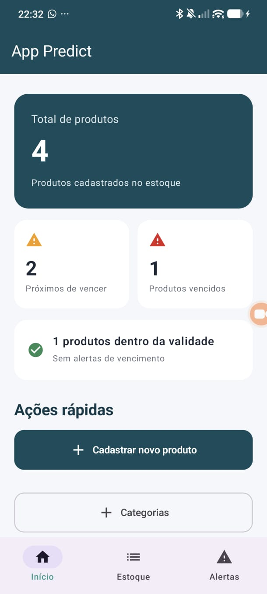
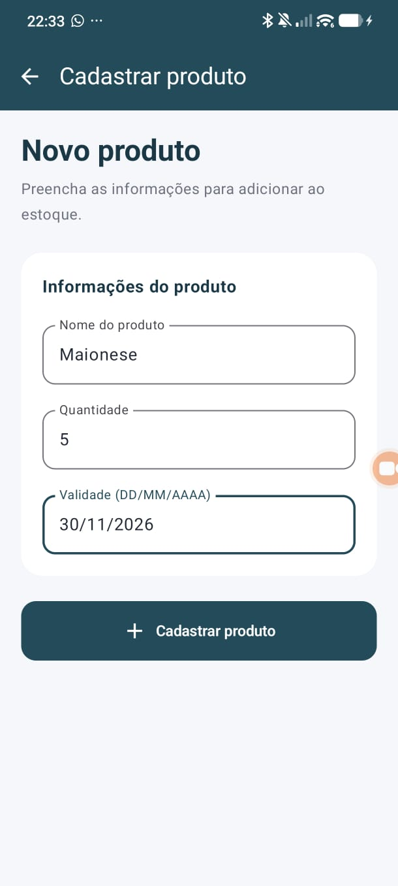
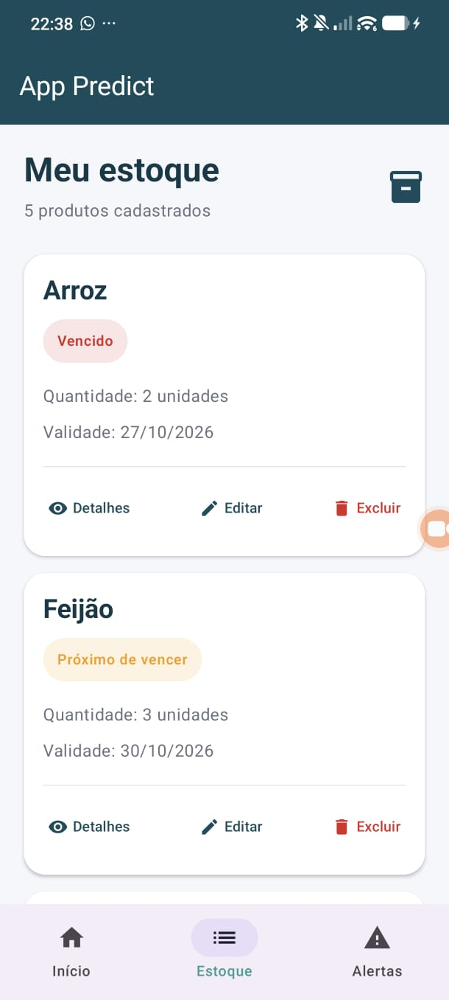
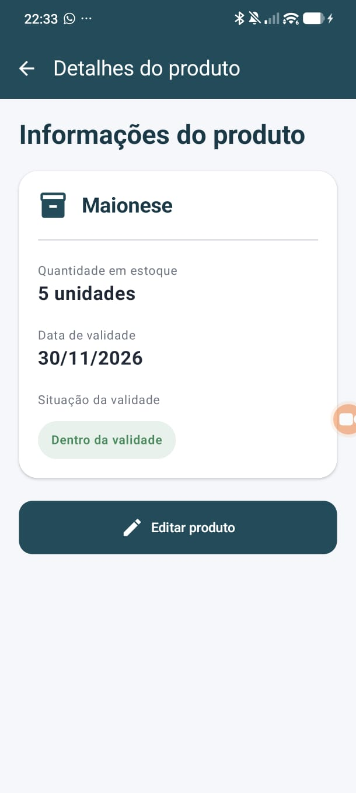
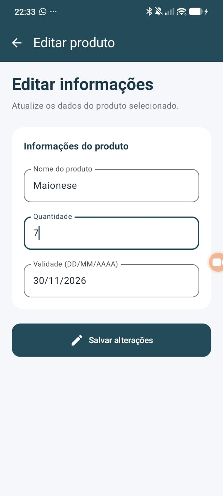
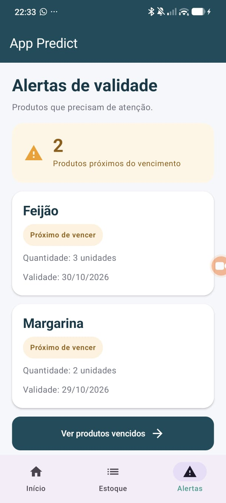
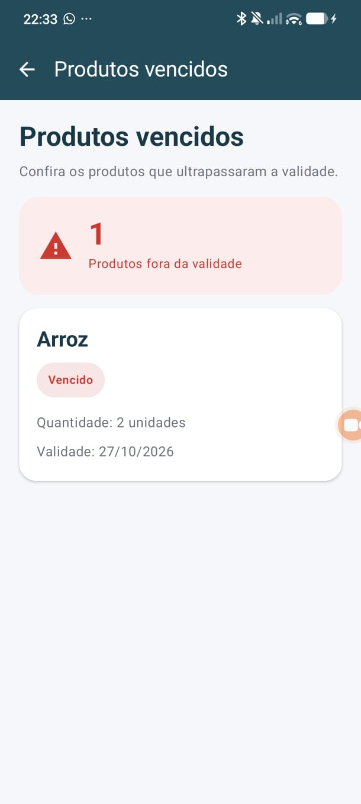
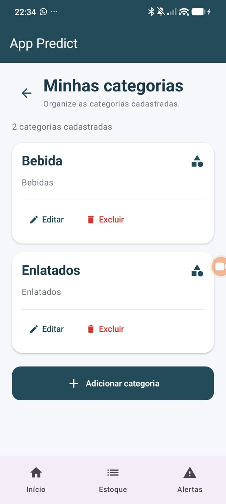
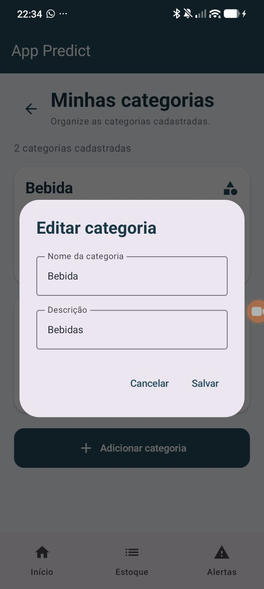

# 📦 App Predict
### Sistema de Gerenciamento de Estoque e Controle de Validade

**Trabalho 3 — Persistência de Dados com Room**

---

## 1. Apresentação do projeto

O **App Predict** é um aplicativo Android desenvolvido para auxiliar no gerenciamento de estoques e no acompanhamento da validade de produtos.

O aplicativo permite cadastrar, consultar, editar e excluir produtos, além de identificar aqueles que estão próximos do vencimento ou que já ultrapassaram sua data de validade.

Também oferece uma área para gerenciamento de categorias e utiliza um banco de dados local para manter as informações salvas mesmo após o encerramento do aplicativo.

### Objetivos

- Facilitar a organização de produtos em estoque.
- Armazenar informações de nome, quantidade e validade.
- Identificar produtos próximos do vencimento.
- Exibir separadamente os produtos vencidos.
- Permitir o gerenciamento de categorias.
- Implementar operações de cadastro, consulta, edição e exclusão.
- Garantir a persistência local dos dados utilizando Room.

---

## 2. Evolução do Trabalho 2 para o Trabalho 3

### Trabalho 2 — Armazenamento em memória

Na etapa anterior, o aplicativo já possuía telas para cadastro, visualização, edição e exclusão de produtos, além do acompanhamento da validade.

Entretanto, os dados eram armazenados em uma lista mantida na memória do aplicativo. Ao encerrar sua execução, os registros não permaneciam salvos.

### Trabalho 3 — Persistência com Room

Nesta etapa, implementamos o Room para armazenar os registros em um banco SQLite local.

A principal melhoria foi permitir que os dados continuem disponíveis após fechar e abrir novamente o aplicativo.

Também foi criada a entidade Categoria, com operações próprias de cadastro, consulta, edição e exclusão.

| Funcionalidade | Trabalho 2 | Trabalho 3 |
|---|---|---|
| Cadastro de produtos | Sim | Sim |
| Listagem do estoque | Sim | Sim |
| Edição e exclusão | Sim | Sim |
| Controle de validade | Sim | Sim |
| Consulta de detalhes | Sim | Sim |
| Persistência local | Não | Sim |
| Banco Room | Não | Sim |
| Gerenciamento de categorias | Não | Sim |
| Duas entidades e dois DAOs | Não | Sim |

---

## 3. Como utilizar o aplicativo

O App Predict possui uma interface com navegação entre as telas de Início, Estoque e Alertas, além de telas específicas para os formulários e o gerenciamento de categorias.

### 3.1. Tela inicial

A tela inicial apresenta uma visão geral dos produtos cadastrados.

São exibidos indicadores com:

- Total de produtos cadastrados.
- Quantidade de produtos próximos do vencimento.
- Quantidade de produtos vencidos.
- Quantidade de produtos dentro da validade.

Também existem dois botões de acesso rápido:

**Cadastrar novo produto:** abre o formulário de cadastro de produtos.

**Categorias:** abre a tela que apresenta as categorias cadastradas.

Os indicadores são calculados a partir dos produtos carregados do banco de dados.

### 3.2. Cadastro de produtos

O formulário de cadastro possui três campos:

| Campo | Descrição | Exemplo |
|---|---|---|
| Nome | Nome do produto | Arroz |
| Quantidade | Quantidade disponível | 10 |
| Validade | Data de vencimento | 30/11/2026 |

**Passo a passo:**

1. Abra o aplicativo.
2. Na tela inicial, toque em **Cadastrar novo produto**.
3. Digite o nome do produto.
4. Informe a quantidade disponível.
5. Digite a data de validade no formato `DD/MM/AAAA`.
6. Toque em **Cadastrar produto**.

O aplicativo verifica se o nome foi preenchido, se a quantidade é válida e se a data informada representa uma data existente.

Após a validação, o registro é enviado para o banco de dados por meio do `ProdutoDAO`.

O identificador do produto é gerado automaticamente pelo Room.

### 3.3. Tela de Estoque

A tela Estoque apresenta os produtos registrados no aplicativo.

Cada produto é exibido em um cartão com informações e opções de gerenciamento.

As operações disponíveis são:

- **Detalhes:** consultar as informações específicas de um produto.
- **Editar:** modificar os dados de um produto existente.
- **Excluir:** remover um registro do estoque.

A listagem utiliza `LazyColumn`, componente do Jetpack Compose utilizado para apresentar listas.

Após operações de cadastro, edição ou exclusão, os dados são consultados novamente para atualizar a interface.

### 3.4. Detalhes de um produto

A tela de Detalhes apresenta as informações de um produto selecionado.

Quando o usuário abre essa tela, o aplicativo utiliza o identificador do registro para realizar uma consulta específica ao banco de dados.

A consulta utilizada é:

```sql
SELECT * FROM produtos WHERE id = :id
```

O objetivo é recuperar diretamente o produto solicitado, sem depender apenas da lista apresentada na tela de Estoque.

São exibidos o nome, a quantidade, a validade e a situação do produto.

### 3.5. Edição de produtos

A edição permite atualizar os dados de um produto já cadastrado.

Para editar:

1. Acesse o Estoque.
2. Localize o produto desejado.
3. Toque em **Editar**.
4. Modifique as informações.
5. Salve as alterações.

O registro mantém seu identificador original, enquanto seus dados são atualizados no banco por meio de `@Update`.

### 3.6. Exclusão de produtos

O usuário pode remover produtos que não precisam mais permanecer cadastrados.

Ao selecionar **Excluir**, o aplicativo executa a operação correspondente no DAO.

A exclusão utiliza a anotação `@Delete` do Room.

Após a operação, a listagem é atualizada para refletir a remoção.

### 3.7. Alertas de validade

A tela Alertas identifica produtos próximos de vencer.

O aplicativo compara a validade cadastrada com a data atual do dispositivo.

São consideradas três situações:

| Situação | Descrição |
|---|---|
| Dentro da validade | Produto fora do período de alerta |
| Próximo do vencimento | Produto dentro do período de atenção de sete dias |
| Vencido | Produto cuja data de validade já passou |

Os produtos próximos do vencimento são apresentados em cartões com suas respectivas informações.

**Observação:** os alertas são exibidos dentro do aplicativo. A versão atual não utiliza notificações automáticas no celular.

### 3.8. Produtos vencidos

Na seção de Alertas, existe o botão **Ver produtos vencidos**.

Essa função abre uma tela dedicada à consulta dos produtos cuja data de validade já foi ultrapassada.

A tela apresenta a quantidade total de registros vencidos e os cartões correspondentes.

Quando não existem produtos vencidos, uma mensagem informa essa situação.

### 3.9. Gerenciamento de categorias

Na tela inicial, o botão **Categorias** permite acessar o gerenciamento de categorias cadastradas.

A tela apresenta uma lista de cartões contendo o nome e a descrição de cada categoria.

Em cada cartão, existem as opções:

- **Editar:** modificar nome ou descrição.
- **Excluir:** remover a categoria cadastrada.

No final da listagem, o botão **Adicionar categoria** abre um formulário para cadastrar novos registros.

O formulário apresenta os campos Nome e Descrição.

Após o cadastro, a categoria é armazenada no Room e passa a aparecer na listagem.

**Importante:** nesta versão, as categorias são gerenciadas de maneira independente. Ainda não existe uma associação direta entre cada produto e uma categoria.

---

## 4. Estrutura do banco de dados

O banco de dados foi implementado utilizando Room, com duas entidades e dois DAOs.

### 4.1. Entidade Produto

Arquivo: `Produto.kt`

```kotlin
@Entity(tableName = "produtos")
data class Produto(
    val nome: String,
    val quantidade: Int,
    val validade: String,

    @PrimaryKey(autoGenerate = true)
    val id: Int = 0
)
```

| Atributo | Tipo | Responsabilidade |
|---|---|---|
| id | Int | Identificador único |
| nome | String | Nome do produto |
| quantidade | Int | Quantidade disponível |
| validade | String | Data de validade |

A anotação `@Entity` define a tabela utilizada pelo Room.

A anotação `@PrimaryKey(autoGenerate = true)` permite que o banco gere automaticamente o identificador do registro.

### 4.2. Entidade Categoria

Arquivo: `Categoria.kt`

```kotlin
@Entity(tableName = "categorias")
data class Categoria(
    val nome: String,
    val descricao: String,

    @PrimaryKey(autoGenerate = true)
    val id: Int = 0
)
```

| Atributo | Tipo | Responsabilidade |
|---|---|---|
| id | Int | Identificador único |
| nome | String | Nome da categoria |
| descricao | String | Descrição da categoria |

Essa entidade possui sua própria tabela e suas operações de gerenciamento.

### 4.3. ProdutoDAO

Arquivo: `ProdutoDAO.kt`

O `ProdutoDAO` concentra as operações de banco relacionadas aos produtos.

| Operação | Anotação | Função |
|---|---|---|
| Cadastrar | `@Insert` | Inserir um produto |
| Listar | `@Query` | Consultar todos os produtos |
| Buscar por ID | `@Query` | Consultar um produto específico |
| Editar | `@Update` | Atualizar um produto |
| Excluir | `@Delete` | Remover um produto |

**Consulta de listagem:**

```sql
SELECT * FROM produtos
```

**Consulta filtrada:**

```sql
SELECT * FROM produtos WHERE id = :id
```

### 4.4. CategoriaDAO

Arquivo: `CategoriaDAO.kt`

O `CategoriaDAO` concentra as operações relacionadas às categorias.

| Operação | Anotação | Função |
|---|---|---|
| Cadastrar | `@Insert` | Inserir uma categoria |
| Listar | `@Query` | Consultar todas as categorias |
| Buscar por ID | `@Query` | Consultar uma categoria específica |
| Editar | `@Update` | Atualizar uma categoria |
| Excluir | `@Delete` | Remover uma categoria |

As consultas SQL incluem:

```sql
SELECT * FROM categorias
```

```sql
SELECT * FROM categorias WHERE id = :id
```

### 4.5. AppDatabase

Arquivo: `AppDatabase.kt`

A classe `AppDatabase` centraliza a configuração do banco de dados e reúne as entidades Produto e Categoria.

Ela disponibiliza os DAOs responsáveis por acessar cada tabela.

Foi utilizado o padrão Singleton, seguindo o exemplo apresentado em aula, para compartilhar uma instância do banco dentro do aplicativo.

---

## 5. Funcionamento da persistência

A persistência de dados foi a principal melhoria realizada no Trabalho 3.

### Como os registros são armazenados?

O processo de cadastro segue estas etapas:

1. O usuário preenche o formulário.
2. O aplicativo verifica os dados informados.
3. Um objeto correspondente à entidade é criado.
4. A operação é encaminhada ao DAO.
5. O Room executa a inserção no banco SQLite.
6. Uma nova consulta permite atualizar a listagem exibida.

As operações de acesso ao banco utilizam corrotinas e `Dispatchers.IO`, evitando executá-las diretamente na thread principal.

### Como os dados são recuperados?

As telas utilizam consultas realizadas pelos DAOs para recuperar os registros armazenados.

Os produtos consultados também são mantidos no `MeuViewModel`, permitindo atualizar as informações apresentadas nas diferentes telas.

Na tela de Detalhes, o produto é consultado diretamente pelo identificador.

### O que acontece ao fechar o aplicativo?

Os dados permanecem armazenados no banco SQLite local.

Quando o aplicativo é aberto novamente, os registros podem ser consultados e apresentados nas telas.

Esse funcionamento não exige conexão com um servidor externo.

---

## 6. Organização dos principais arquivos

Os arquivos do aplicativo estão organizados no pacote `com.example.apppredict20`.

| Arquivo | Função |
|---|---|
| `MainActivity.kt` | Inicialização do aplicativo |
| `AppTheme.kt` | Cores e configurações visuais |
| `AppNavigation.kt` | Navegação principal e integração com o banco |
| `Rotas.kt` | Definição das rotas |
| `BottomNavBar.kt` | Barra inferior |
| `MeuViewModel.kt` | Estado dos produtos na interface |
| `Produto.kt` | Entidade Produto |
| `Categoria.kt` | Entidade Categoria |
| `ProdutoDAO.kt` | Operações de produtos |
| `CategoriaDAO.kt` | Operações de categorias |
| `AppDatabase.kt` | Configuração do Room |
| `TelaInicio.kt` | Painel inicial |
| `TelaCadastro.kt` | Cadastro de produtos |
| `TelaEstoque.kt` | Listagem de produtos |
| `TelaEditar.kt` | Edição de produtos |
| `TelaDetalhes.kt` | Informações de um produto |
| `TelaVencidos.kt` | Produtos vencidos |
| `TelaCategorias.kt` | Gerenciamento de categorias |
| `TelaComAbas.kt` | Navegação entre as telas principais |

---

## 7. Tecnologias utilizadas

| Tecnologia | Aplicação no projeto |
|---|---|
| Kotlin | Linguagem de programação |
| Android Studio | Ambiente de desenvolvimento |
| Jetpack Compose | Desenvolvimento da interface |
| Material Design 3 | Componentes visuais |
| Navigation Compose | Navegação entre telas |
| Room | Persistência local |
| SQLite | Armazenamento de dados |
| KSP | Processamento das anotações do Room |
| Coroutines | Operações em segundo plano |
| ViewModel | Gerenciamento de estado |
| Git e GitHub | Versionamento do projeto |

---

## 8. Como executar o projeto

### Obter o código

Acesse:

https://github.com/JoaoBaptistaJK-pixel/App_Predict_2.1

Selecione **Code → Download ZIP** ou clone o repositório usando Git.

### Abrir o projeto

1. Inicie o Android Studio.
2. Clique em **Open**.
3. Selecione a pasta do projeto.
4. Aguarde a sincronização do Gradle.
5. Verifique se não existem erros de configuração.

### Executar

1. Selecione a configuração `app`.
2. Escolha um emulador Android ou dispositivo físico.
3. Clique em **Run**.
4. Aguarde a instalação e a abertura do aplicativo.

Após iniciar, a tela de Visão geral será apresentada.

---

## 9. Dificuldades encontradas e soluções

### Integração do banco de dados

Uma das principais dificuldades foi adaptar um aplicativo que armazenava os produtos em memória para utilizar o Room.

**Solução:** criamos as entidades e os DAOs e adaptamos as operações existentes para utilizar o banco de dados local.

### Atualização das listas

Foi necessário garantir que as informações exibidas fossem atualizadas após operações de cadastro, edição e exclusão.

**Solução:** implementamos novas consultas aos DAOs após as operações, atualizando os dados apresentados nas telas.

### Identificadores automáticos

A identificação dos produtos precisou ser adaptada ao modelo utilizado pelo Room.

**Solução:** adotamos identificadores inteiros com geração automática por meio da anotação `@PrimaryKey(autoGenerate = true)`.

### Implementação da segunda entidade

O trabalho exigia duas entidades diferentes, cada uma com seu próprio DAO.

**Solução:** acrescentamos a entidade Categoria e desenvolvemos uma tela dedicada ao seu gerenciamento.

### Organização da interface de categorias

Inicialmente, o formulário de cadastro e a listagem das categorias estavam concentrados na mesma tela.

Para melhorar a organização, a interface foi ajustada para apresentar primeiro os cartões e disponibilizar o formulário por meio do botão Adicionar categoria.

---

## 10. Testes de funcionamento

Os testes foram organizados para verificar as operações CRUD e a persistência dos registros.

### Produtos

| Teste | Resultado esperado |
|---|---|
| Cadastrar produto | Produto aparece no Estoque |
| Informar dados inválidos | Mensagem de validação |
| Consultar estoque | Produtos são listados |
| Abrir detalhes | Produto é consultado pelo ID |
| Editar produto | Informações são atualizadas |
| Excluir produto | Registro é removido |
| Fechar e reabrir | Registros restantes continuam salvos |

### Categorias

| Teste | Resultado esperado |
|---|---|
| Cadastrar categoria | Categoria aparece na lista |
| Editar categoria | Dados são atualizados |
| Excluir categoria | Registro é removido |
| Fechar e reabrir | Categorias restantes continuam salvas |

Durante o desenvolvimento, foram realizados testes de cadastro e edição de categorias, incluindo a verificação da persistência após fechar e reabrir o aplicativo.

As evidências da versão final serão apresentadas por meio das capturas de tela e gravações de funcionamento.

---

## 11. Evidências do aplicativo

Esta seção reúne as imagens e os vídeos utilizados para demonstrar as funcionalidades implementadas.

### Capturas de tela

**Figura 1 — Tela inicial**


  

**Figura 2 — Cadastro de produtos**

Formulário utilizado para cadastrar produtos com nome, quantidade e data de validade.



**Figura 3 — Estoque**

Listagem dos produtos cadastrados, com informações de validade e opções de consultar detalhes, editar ou excluir.



**Figura 4 — Detalhes do produto**

Consulta individual de um produto, apresentando suas informações e a situação da validade.



**Figura 5 — Edição de produtos**

Formulário de atualização das informações de um produto existente.



**Figura 6 — Alertas de validade**

Produtos identificados como próximos do vencimento, com destaque visual para a situação de alerta.



**Figura 7 — Produtos vencidos**

Listagem específica dos produtos que ultrapassaram a data de validade.



**Figura 8 — Gerenciamento de categorias**

Categorias cadastradas, exibidas em cartões com opções de edição e exclusão.



**Figura 9 — Edição de categorias**

Formulário de edição do nome e da descrição de uma categoria cadastrada.




### Vídeos de demonstração

Os vídeos abaixo apresentam o funcionamento do App Predict em duas etapas do desenvolvimento, permitindo visualizar a evolução do aplicativo.

#### 🎬 Trabalho 2 — Versão anterior

Demonstração da versão anterior do App Predict, com as funcionalidades de gerenciamento de produtos e controle de validade, antes da implementação da persistência com Room.

[▶️ Assistir ao vídeo do Trabalho 2](https://drive.google.com/file/d/1nFc7S3BBMegZCedQ0L5xJkK1q8yfhy_t/view?usp=sharing)

#### 🎬 Trabalho 3 — Versão atual

Demonstração da versão atual do App Predict, desenvolvida com persistência de dados utilizando Room e com o gerenciamento de produtos e categorias.

[▶️ Assistir ao vídeo do Trabalho 3](https://drive.google.com/file/d/1xlR0gcYRHbHvtnJeX8Ybyrci6raELnla/view?usp=sharing)


---

## 12. Possíveis melhorias futuras

Embora o aplicativo possua as funcionalidades propostas para esta etapa, existem possibilidades de aprimoramento:

- Associar categorias diretamente aos produtos.
- Adicionar pesquisa pelo nome dos produtos.
- Criar filtros adicionais para o estoque.
- Implementar notificações automáticas de vencimento.
- Permitir exportação de informações.
- Adicionar backup ou sincronização de dados.

Essas funcionalidades são propostas futuras e não fazem parte da versão atual.

---

## 13. Considerações finais

O desenvolvimento do Trabalho 3 permitiu evoluir o App Predict de um aplicativo com armazenamento temporário para uma aplicação com persistência local.

A implementação do Room possibilitou armazenar e recuperar produtos e categorias em um banco de dados SQLite, mantendo os registros disponíveis entre diferentes execuções.

Também foi possível aplicar conceitos como entidades, identificadores automáticos, DAOs, consultas SQL, operações CRUD e corrotinas.

As funcionalidades anteriores foram preservadas, enquanto novas possibilidades de gerenciamento foram acrescentadas ao aplicativo.

O resultado é um sistema de gerenciamento de estoque e controle de validade com uma interface organizada e armazenamento local de dados.

---

## 14. Integrantes e participação da equipe

**Projeto:** App Predict

**Integrantes:**

- João Vitor Baptista
- João Rubens Brandt Neto

### Participação da equipe

O desenvolvimento do App Predict foi organizado em dupla, considerando as diferentes etapas necessárias para a construção e evolução do aplicativo. O trabalho envolveu o planejamento das funcionalidades, a organização da interface, a implementação dos recursos solicitados e a realização de ajustes para adequar o projeto aos requisitos estabelecidos.

Ao longo do desenvolvimento, foram considerados aspectos como funcionamento das telas, organização do código, integração com o banco de dados e verificação das principais operações do aplicativo. O objetivo foi manter uma aplicação funcional, de utilização simples e alinhada aos conceitos apresentados em aula.

---

*Projeto acadêmico desenvolvido para fins de aprendizagem e aplicação prática de conceitos de desenvolvimento Android e persistência de dados.*
